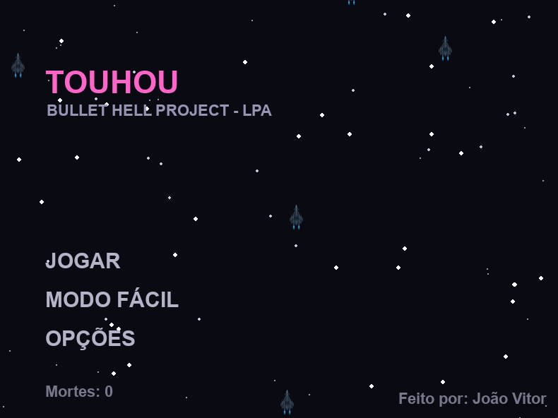
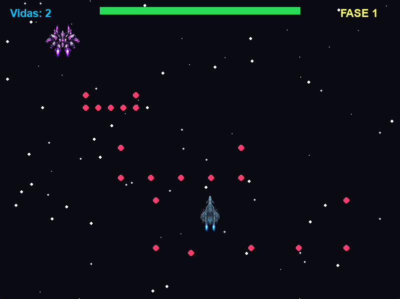
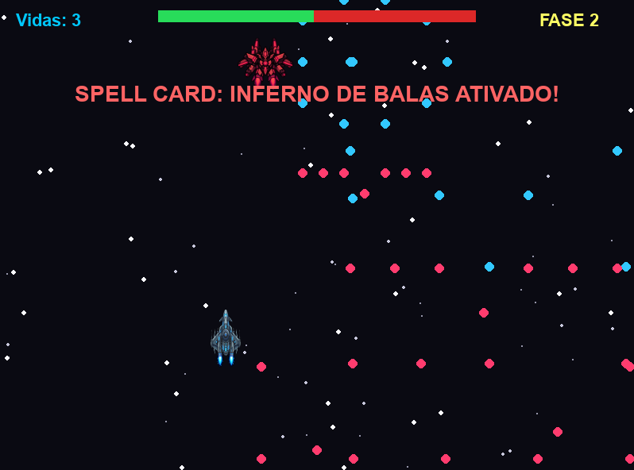

# 🎮 Touhou Style - LPA

Um jogo 2D estilo Bullet Hell desenvolvido em Python com Pygame, como projeto da disciplina de Linguagem de Programação Aplicada.

O jogador precisa enfrentar um chefe, desviar de projéteis e sobreviver aos ataques até derrotá-lo.

## 🕹️ Sobre o jogo

O projeto possui uma batalha contra um chefe com duas fases, cada uma com padrões de ataque diferentes. Conforme a batalha avança, o chefe se torna mais agressivo, aumentando o desafio para o jogador.

O jogo conta com diferentes modos de dificuldade, efeitos visuais, trilha sonora e telas de vitória e derrota.

## ✨ Funcionalidades

- Menu principal.
- Movimentação do jogador.
- Sistema de disparos.
- Boss com duas fases.
- Padrões de ataque diferentes.
- Sistema de vidas.
- Invulnerabilidade temporária após sofrer dano.
- Três modos de jogo: Normal, Fácil e Teste.
- Modo Teste (God Mode).
- Efeitos de explosão ao derrotar o boss.
- Efeitos visuais de dano.
- Música e efeitos sonoros.
- Tela de vitória e Game Over.
- Transições entre telas.

## 🎯 Objetivo

Desviar dos projéteis do chefe, sobreviver aos ataques e derrotá-lo para concluir a partida.

## 🎮 Controles

| Tecla | Ação |
|---|---|
| W / ↑ | Mover para cima |
| S / ↓ | Mover para baixo |
| A / ← | Mover para esquerda |
| D / → | Mover para direita |
| Espaço | Atirar |

## 🎵 Trilha sonora

O jogo possui trilhas sonoras diferentes para o menu e os modos de jogo.

| Local | Música |
|---|---|
| Menu | Highly Responsive to Prayers (Original) – Eternal Shrine Maiden |
| Modo Normal | REDASH – Desert Stage (GODDESS OF VICTORY: NIKKE OST) |
| Modo Fácil | Foggy Sunrise – Glass Gardens (Loop) |

## 📸 Screenshots

### Menu principal


### Gameplay – Fase 1


### Gameplay – Fase 2


## 🛠️ Tecnologias utilizadas

- Python
- Pygame
- PyInstaller

## ▶️ Como executar o projeto

### Executar pelo Python

1. Instale o Python.
2. Instale o Pygame:

```bash
pip install pygame
```

3. Execute o arquivo principal:

```bash
python main.py
```

### Executar a versão compilada

O jogo também possui uma versão compilada para Windows, permitindo executá-lo sem precisar abrir uma IDE ou instalar o Python.

Execute o arquivo `TouhouGame.exe` presente na pasta do jogo compilado.

## 📁 Estrutura do projeto

```text
TouhouGame/
├── assets/
│   ├── images/
│   └── music/
├── screenshots/
│   ├── menu.png
│   ├── fase1.png
│   └── fase2.png
├── main.py
└── README.md
```

## 👨‍💻 Desenvolvedor

**João Vitor**

Projeto desenvolvido para a disciplina de Linguagem de Programação Aplicada.

---

Obrigado por conferir o projeto! 🎮